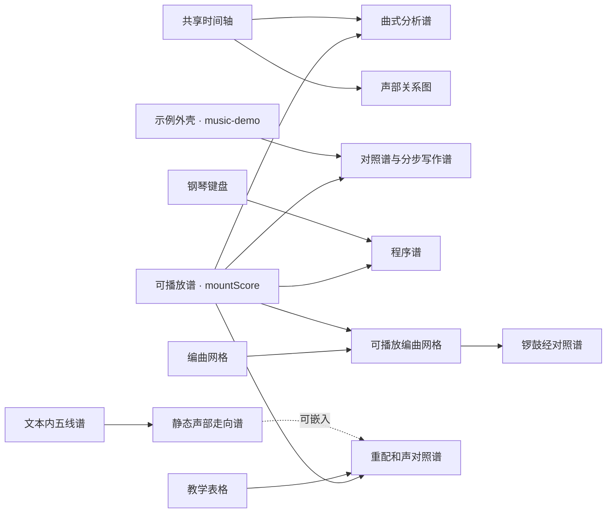

# 样式与格式的继承关系

[格式样板与继承索引](../content/format-library.html#format-inheritance) · [程序谱目录](../content/programmatic-scores.html) · [课程首页](../content/index.html)

本页记录现有的共用样式、教学格式和书目专用样式。表中「复用来源」指实际采用的 CSS 类、图形资产或组件。CSS 级联负责外观，多个组件也可以组合成一种教学格式。

## 站点基础

| 层级 | 实现 | 覆盖范围 |
| --- | --- | --- |
| 配色与主题 | [themes.css](../content/shared/themes.css) · [themes.js](../content/shared/themes.js) | 根元素的 `data-theme` 提供背景、文字、边线、谱面及键位色。设置在本地保存。九种主题为纸白、米浆、雾蓝、淡紫、烟粉、薄荷、琥珀、石墨、午夜蓝。 |
| 页面排版 | [style.css](../content/shared/style.css) | 正文字体、阅读宽度、页眉、设置面板、书架、书目目录、资源入口。 |
| 控件 | [controls.css](../content/shared/controls.css) | 由 `style.css` 导入。按钮、下拉框、搜索框及入口链接共用尺寸、焦点和选中状态。播放键、分段选择及主题选项有各自修饰。 |
| 章内导航与阅读布局 | [chapter.css](../content/shared/chapter.css) · [chapter-layout.js](../content/shared/chapter-layout.js) · [readable-layout.js](../content/shared/formats/readable-layout.js) | 路径、目录、上下章导航。阅读布局给教学表和长谱加局部滚动容器，实际溢出时提供焦点与滚动提示。时间轴、指板和编曲网格也可调用同一滚动工具。 |
| 教学组件 | [formats.css](../content/shared/formats/formats.css) | 表格、选学、强调、静态谱、乐器图、播放器、时间轴和交互外壳。依赖主题变量和控件基线。 |
| 程序谱检索 | [score-catalogue.css](../content/shared/score-catalogue.css) · [score-catalogue.js](../content/shared/score-catalogue.js) | 程序谱目录按书、章节与谱例组织，并提供筛选。条目指向章节中的实际组件。 |

## 正文、表格和静态记谱

| 格式 | 复用来源 | 用法与示例 |
| --- | --- | --- |
| 正文、普通列表、定义列表 | `style.css` 的正文和字体规则 | 定义、规则、因果和少量举例。[正文样板](../content/format-library.html#reading-samples) |
| 选学、补充说明 | `details.lesson-aside`、`lesson-aside-content` | 默认折叠的排版惯例、细节或扩展规则。[样板](../content/format-library.html#reading-samples) |
| 强调块 | `aside.lesson-callout` | 常显的定义、规则和结论。[样板](../content/format-library.html#reading-samples) |
| 教学表格 | `lesson-table` → `table-scroll`，可加 `lesson-table-wide`、`signature-table` 等修饰 | 比较定义、记法、音值、音域。宽表使用同一滚动规则。和弦公式、声部进行比较与逐小节和声修订也沿用该表格底座。[教学表](../content/format-library.html#table-sample) · [宽表](../content/format-library.html#wide-table-sample) |
| 分数、数字拍号 | `fraction`、`time-signature` | 正文与单元格内的上下两数用横线分隔。五线谱上的拍号按记谱惯例排版。[样板](../content/format-library.html#static-samples) |
| 单个记号、记号组、术语 | 本地 Bravura 字体；`music-symbol`、`dynamic-mark`、`music-term`、`tempo-range`；`notation-sample` 为组图容器 | 可直接嵌入句子或表格。力度字形与意大利语术语各有样式。[速度与力度](../content/books/music-theory/chapter-12.html) |
| 文本内五线谱 | `svg.inline-staff`、`inline-staff-lines`、Bravura | 静态 HTML 和 SVG。默认只画当前知识点所需的谱线和记号，适合句内、列表及表格。加 `inline-staff-wide` 可放稍长片段。[手写规范样板](../content/format-library.html#static-samples) |
| 独立静态谱、音阶谱 | `inline-staff` 加 `scale-overlap` 或 `long-staff`，宽谱接入 `staff-scroll` | `scale-overlap` 用于共用线距的音列对比。半音阶、调式对照等再加各自的标注样式。[半音阶长谱样板](../content/format-library.html#static-samples) |
| 静态音程图、分类树 | `interval-examples` 使用 Bravura 和谱线；`classification-tree` 使用嵌套列表 | 静态音程图并列短谱；分类树呈现分类及下级项目。[音程图样板](../content/format-library.html#interval-title) · [协和分类](../content/books/music-theory/chapter-4.html) |
| 静态声部走向谱 | `inline-staff` 加 `voice-leading-staves`、`voice-leading-panel`、`voice-leading-staff` | 用连线标明同一声部的音高变化。也可嵌入和声对照，或接入分步试听。[样板与变体](../content/format-library.html#voice-leading-sample) |
| 演奏路线 | [mountRepeatRoute](../content/shared/formats/repeat-route.js) → `inline-staff route-staff` ＋ 局部滚动 | 用小节图、步骤按钮和当前小节高亮解释反复遍历；推进由按钮控制。[样板](../content/format-library.html#library-route) |
| 双手时值图 | [renderRhythmPattern](../content/shared/formats/accompaniment-patterns.js) ＋ 共用拍线与主题 | 各小节按拍对齐声部。事件用小节占比 `start`、`end` 与 `attack`、`hold`、`rest` 表示。可用 `roles` 填写 `name` 和相对 `octave`。[样板](../content/format-library.html#rhythm-pattern-sample) |
| 和弦时值图 | [renderHarmonyPattern](../content/shared/formats/accompaniment-patterns.js) ＋ 共用拍线与主题 | 按 `span` 比例划分和弦区间，显示级数与和弦名，转位时保留斜线低音。[样板](../content/format-library.html#harmony-pattern-sample) |

## 键盘、指板和音域

| 格式 | 复用来源 | 用法与示例 |
| --- | --- | --- |
| 静态钢琴键盘 | [piano.svg](../content/shared/formats/piano.svg) ＋ `keyboard-example` | 用 SVG 的 `use` 直接引用黑白键轮廓和标记，无需 JavaScript。[样板](../content/format-library.html#keyboard-example) |
| 批量键盘与音程图鉴 | [piano.js](../content/shared/formats/piano.js) → `pianoKeysMarkup`、`pianoMarkup` → [keyboard-intervals.js](../content/shared/formats/keyboard-intervals.js) | 共用琴键资产，按相对半音位置绘图；可并列显示同度数的不同音程。[样板](../content/format-library.html#keyboard-intervals) |
| 谱键对照图 | `piano.svg` ＋ 书目专用静态五线谱和对齐坐标 | 符头与琴键沿同一横坐标对齐。谱面和键盘一起滚动。[音列分组](../content/books/music-theory/chapter-3.html#pitch-octaves) |
| 音域键盘 | [range-keyboards.js](../content/shared/formats/range-keyboards.js) → `pianoKeysMarkup` | 从音域表读取实音、边界、断档和空弦，绘到等距半音的琴键上。[弓弦乐器](../content/books/orchestration/orchestration-2.html#string-ranges) |
| 横向音域图与共用谱表音域图 | [instrument-range-charts.js](../content/shared/formats/instrument-range-charts.js) ＋ `readInstrumentRanges`、`semitone` | 在同一音高尺度上比较多种乐器。总览中的两种图与键盘视图共用音域表；章节也有手绘共用谱表版本。[音域总览](../content/books/orchestration/instrument-ranges.html) · [静态木管谱表](../content/books/orchestration/orchestration-3.html#woodwind-vertical-ranges) |
| 弦乐器指板图 | [mountFretboard](../content/shared/formats/fretboard.js) ＋ 局部滚动 | 一个弦上可标多个品位，可连线表示运动方向。适合音阶、把位和移调。[样板](../content/format-library.html#fretboard-samples) |
| 吉他和弦指板 | [mountGuitarChordDiagrams](../content/shared/formats/guitar-chord-diagram.js) ＋ 主题变量 | 独立的纵向和弦图，一弦一个位置，可显示空弦、消音、横按和根音。[样板](../content/format-library.html#guitar-chord-samples) |

## 可播放谱与教学交互

下面的箭头由基础组件指向使用它的格式。

| 格式 | 复用来源 | 用法与示例 |
| --- | --- | --- |
| 通用谱例播放器 | [mountScore](../content/shared/formats/score.js) → alphaTab、[four-part.js](../content/shared/formats/four-part.js)、局部滚动 | `notation` 切换五线谱、简谱或上下对照；`audio: false` 仍由 alphaTab 排谱；`notationVisible: false` 隐藏谱面、保留试听。多轨、音色、光标、全页互斥播放都由同一接口处理。[双谱样板](../content/format-library.html#sample-title) |
| 四部和声、带伴奏旋律 | [harmony-score.js](../content/shared/formats/harmony-score.js) → `four-part.js` → `mountScore` | 数据标记为四部和声后，播放器提供钢琴／弦乐切换。多轨合奏也使用 `mountScore`，由各轨指定乐器。[和声下册](../content/books/harmony-lower/) · [朋克合奏](../content/books/genre-arrangement/genre-arrangement-9.html#genre-punk-arrangement) |
| 读谱、选段、分声部与音符标注 | `mountScore` ＋ [score-reading.js](../content/shared/formats/score-reading.js)、[score-sections.js](../content/shared/formats/score-sections.js)、[score-note-highlights.js](../content/shared/formats/score-note-highlights.js) | 分别提供音名与和弦、段落位置、指定音的分析高亮。用 `voiceAudition` 可指定试听声部。移动端曲式分析谱另外用 [score-reader.js](../content/shared/formats/score-reader.js) 打开阅读弹层。 |
| 程序谱与键盘 | [mountProgrammaticScore](../content/shared/formats/programmatic-score.js) → `mountScore` ＋ `pianoKeysMarkup` | 表单驱动 `build(choices)`，由同一次计算生成乐谱、音高和文字。音阶、和弦等数据可取自 [scales.js](../content/shared/formats/scales.js) 和 [chords.js](../content/shared/formats/chords.js)，两者共用 [pitch.js](../content/shared/formats/pitch.js)。[大调音阶](../content/books/music-theory/chapter-5.html#major-scale-example) |
| 示例外壳与选择按钮 | `music-demo`、`music-demo-toolbar`、`music-demo-cue` ＋ 可选的 [score-choice-buttons.js](../content/shared/formats/score-choice-buttons.js) | 提供题名、控件和说明的共同排版。各书可用自身脚本更新内部组件，`programmatic-score` 类也可用于这些书目专用示例。[样板](../content/format-library.html#comparison-samples) |
| 装饰音对照 | [mountOrnamentComparison](../content/shared/formats/ornament-comparison.js) → 文本谱记法 ＋ `mountScore` | 同时更新简写记号、展开后的演奏谱和说明。[装饰音](../content/books/music-theory/chapter-13.html) |
| 对照谱 | [mountScoreComparison](../content/shared/formats/score-comparison.js) → 每版各一个 `mountScore` ＋ 选择按钮与音符高亮 | 两份谱同时可见，控件区只显示当前版本的播放键；切换时尽可能保留小节位置。[样板](../content/format-library.html#library-score-comparison) |
| 分步写作谱 | [mountScoreWritingSteps](../content/shared/formats/score-writing-steps.js) → 一个 `mountScore` ＋ 选择按钮与音符高亮 | 切换步骤时更新同一份谱、说明和高亮。[样板](../content/format-library.html#library-writing-steps) |
| 共享时间轴 | [mountTimeline](../content/shared/formats/timeline.js) ＋ 局部滚动 | 多行共用等长时间单位，支持选择和键盘操作。[样板](../content/format-library.html#analysis-samples) |
| 曲式分析谱 | [mountFormAnalysis](../content/shared/formats/form-analysis.js) → `mountTimeline` ＋ `mountScore` ＋ `mountScoreReader` | 段落、小节位置、分析说明和选段试听联动。[样板](../content/format-library.html#library-form-analysis) |
| 声部关系图 | [mountVoiceRelations](../content/shared/formats/voice-relations.js) → `mountTimeline` ＋ 渐变连线 | 空心圆标出原材料，实心圆标出对应项。点选任一端会高亮两端和连线。辅助谱表材料用虚线边框。[样板](../content/format-library.html#library-voice-relations) |
| 编曲网格与可播放编曲网格 | [mountArrangementGrid](../content/shared/formats/arrangement-grid.js) ＋ 局部滚动；[mountPlayableArrangementGrid](../content/shared/formats/arrangement-grid-playback.js) 再组合 `mountScore` | 展示起音、重音、延续和当前拍格。可由网格生成播放轨，或跟随既有演奏谱。时间轴与编曲网格各自渲染，二者共用滚动工具。[样板](../content/format-library.html#arrangement-grid-samples) |
| 锣鼓经对照谱 | 可播放编曲网格 ＋ `text` 拍格、`notationOnly` 口诀行 | 口诀和击法按同一拍格对齐，由分乐器轨发声。[打溜子](../content/books/chinese-orchestration/chinese-orchestration-7.html#gong-syllable-score) |
| 逐小节和声修订与重配和声对照谱 | `lesson-table chord-revision-table`；[mountChordRevision](../content/shared/formats/chord-revision.js) 再组合 `mountScore` 和选择按钮 | 同一张表比较各版和弦，标明拍位、持续和改动；可同步切换静态声部走向谱。[联动样板](../content/books/reharmonization/reharmonization-4.html#reharm-prelude-comparison) |
| 和声落点推导图 | [mountDominantTensionMap](../content/shared/formats/dominant-tension-map.js) → `pitch.js` ＋ `mountScore` ＋ 选择按钮 | 同步显示目标音阶、属和弦延伸音的对应名称和演奏顺序。[样板](../content/format-library.html#dominant-tension-sample) |

## 书目专用样式与组合

| 位置 | 复用关系 |
| --- | --- |
| [基本乐理第三章](../content/books/music-theory/chapter-3.css) | 谱键对照和音名标注使用章节坐标与 SVG，底图沿用 `piano.svg`，谱号沿用 Bravura。 |
| [复调音乐](../content/books/counterpoint/counterpoint-learning.css) | 题头对照、倒影轴、调式图及节奏格有专用排版。写作示范沿用分步写作谱，声部时差用声部关系图，其他复调试听共用 `mountScore`。 |
| [配器法](../content/books/orchestration/orchestration.css) | 总谱布局、泛音位置及音域总览有专用排版；音域图形调用共享渲染器。 |
| [歌曲写作](../content/books/songwriting/songwriting-reference.css) | 谱头样式单独排版；[词曲对齐与版本对照](../content/books/songwriting/songwriting-score.js) 由 `lyricBars` 生成记谱数据，再交给 `mountScore`。PRO 作曲的实例也复用 `lyricBars`。 |
| [乐风编曲](../content/books/genre-arrangement/genre-arrangement-demo.js) · [中国民族器乐配器](../content/books/chinese-orchestration/ensemble-study.js) | 各自提供合奏预设、声部和音色数据，共用示例外壳与多轨播放器。需要对照拍点时使用编曲网格。吉他扫弦的弦位与时间计算来自 [guitar-strum.js](../content/shared/formats/guitar-strum.js)。 |
| [图解编曲案例](../content/books/arrangement/arrangement-case.js) | 曲式分析谱的播放进度驱动同时显示的编曲网格，两处可视化共用一次播放。 |
| [图解重配和声](../content/books/reharmonization/reharmonization-example.js) | 将原版与改写版转成共享和声对照所需的数据，再交给 `mountChordRevision`。 |
| [休闲阅读](../content/books/humor-collection/reading.css) | 「搞笑精品笑话」的分卷、索引和阅读控件有专用样式，沿用站点排版与主题。「快速养猪」「打工而已，别太上头」通过站点基础样式组织阅读。 |
